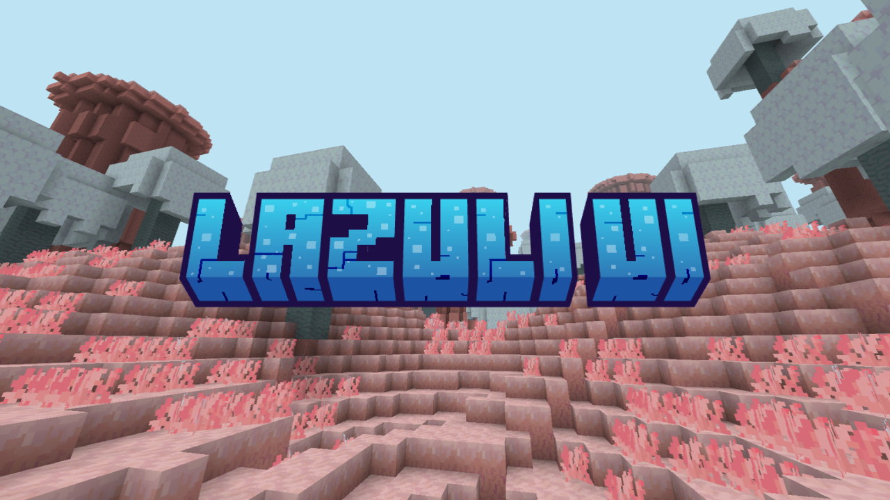

# Lazuli

Lazuli is a dependency-free (in spirit, lol), XML-driven UI framework for SDL3. It powers the [LCE Emerald Launcher](https://github.com/LCE-Hub/LCE-Emerald-Launcher) interface and can be used standalone in any SDL3 application.

## Features (they're weird)

- XML view documents (`<ui>`, `<view>`, `<template>`, `<import>`) loaded from a directory, with a CSS-like (CLS, Cascading Lazuli Stylesheet) styling engine (`<style>` blocks and inline styles)
- Data binding with `{{expressions}}`, `foreach` repetition and `if` conditionals against a JSON data context
- Built-in elements: `column`, `row`, `image`, `label`, `button`, `scroll`, `textinput`, `slider`; extendable through the element registry
- Gamepad-first focus navigation, mouse hover/click handling, text input and slider adjustment
- Toast notifications with a rendered overlay
- SDL3_ttf font cache, texture cache (raster/bitmap/data-URL/SVG via nanosvg) and a scrolling panorama background
- Multi-controller tooltip sets

## Usage

```cmake
add_subdirectory(Lazuli)
target_link_libraries(myapp PRIVATE Lazuli::lazuli)
```

```cpp
SDL_Renderer *renderer = ...;
lazuli::UiSystem ui(renderer, "UiDocs", "public", "resources/i18n");
ui.set_services(&my_services);
ui.set_sounds({...});
ui.set_sound_for(...);
ui.register_screen(std::make_unique<MyScreen>());
if (!ui.initialize()) { ... }
ui.set_language("en");
ui.navigate("home");
```

Write a screen by deriving from `lazuli::Screen` and returning a `lazuli::Json` object from `data()`; the XML documents bind against that JSON.

Custom elements register through `lazuli::ElementRegistry::instance()`.

All framework diagnostic flow through `lazuli::log::set_sink(...)`.

## Dependencies

Lazuli only depends on SDL3, SDL3_ttf, pugixml, nlohmann/json, stb_image, nanosvg (configurable, see CMake options).

## Notes

The Emerald Launcher CONTRIBUTING.md applies to this repository as well. Make sure to follow it.

## License

Lazuli is licensed under the [GNU LGPL-2.1 License](LICENSE).
